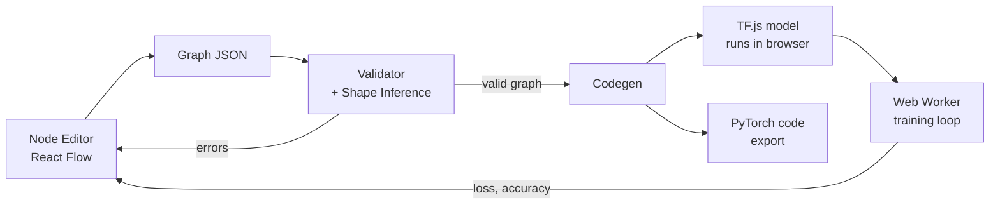
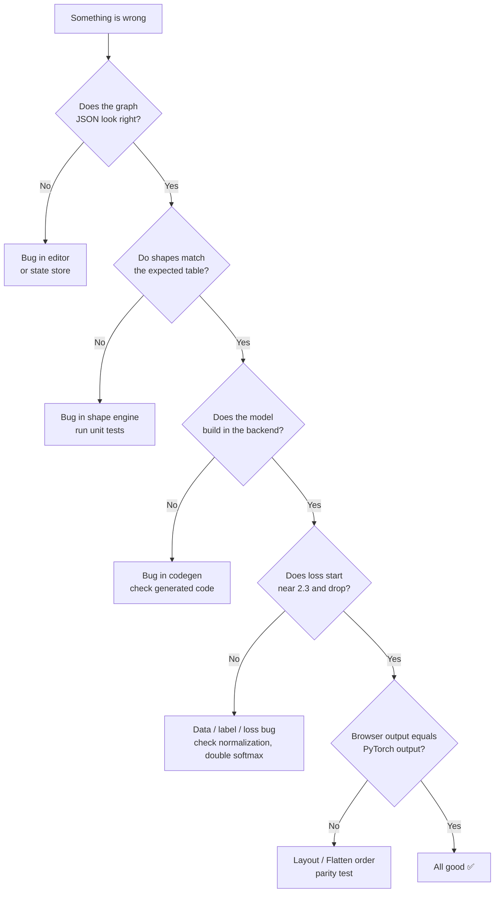

# Node-Based Deep Learning Builder: MVP Guide

> A Blender-style node editor where every layer is a node. Runs fully in the browser (on-device), exports to PyTorch.
> This file is written so that **you** can spot errors visually and so that a **coding agent** can follow it step by step.

**Legend used in this doc**

| Mark | Meaning |
|------|---------|
| ✅ | Build in MVP |
| ⏳ | Later (do NOT build now) |
| ⚠️ | Easy to get wrong |
| 🛑 | Hard rule, never break |
| 🔴 / 🟡 / 🟢 | Error / Warning / OK (also the colors used in the app UI) |

---

## 1. The One-Sentence Goal

> Drag nodes, connect wires, see tensor shapes update live, train on MNIST in the browser, export clean PyTorch code.

If a feature does not help that sentence, it is not in the MVP.

---

## 2. Big Picture

```
 ┌──────────────┐    ┌───────────────┐    ┌──────────────┐    ┌──────────────┐
 │  Node Editor │ →  │  Graph (JSON) │ →  │  Validator + │ →  │   Backends   │
 │ (React Flow) │    │ nodes + wires │    │ Shape Engine │    │ TF.js │ Torch│
 └──────────────┘    └───────────────┘    └──────────────┘    └──────────────┘
        ▲                                         │                    │
        │            errors / shapes shown        │                    ▼
        └─────────────── on nodes & wires ────────┘          Training (Web Worker)
                                                              live loss/accuracy
```



**Golden rule of the architecture 🛑**
The **Graph JSON** and the **Shape Engine** know nothing about TF.js or PyTorch. Backends only *read* the validated graph. This keeps the project swappable later.

---

## 3. Tech Choices (MVP)

| Part | Choice | Why |
|------|--------|-----|
| Language | TypeScript | Types catch graph bugs early |
| Editor | React Flow | Nodes, wires, zoom, minimap built in |
| State | Zustand | Simple store for the graph |
| Runtime | TensorFlow.js (WebGPU backend, WebGL fallback) | Trains in browser today |
| Training thread | Web Worker | UI must never freeze |
| Tests | Vitest | Fast unit tests for shape engine |
| Export | String templates to PyTorch | Simple and debuggable |

⚠️ TF.js is in maintenance mode. That is fine for MVP, which is why the backend must stay swappable.

---

## 4. MVP Scope

### ✅ Build now (16 nodes)

| Group | Node | Parameters |
|-------|------|-----------|
| Data | **Dataset** | MNIST / Fashion-MNIST / CIFAR-10 |
| Data | **Input** | shape (manual) |
| Layers | **Linear** | out_features |
| Layers | **Conv2D** | out_channels, kernel, stride, padding |
| Layers | **MaxPool2D** | kernel, stride |
| Layers | **Flatten** | none |
| Layers | **Dropout** | p |
| Layers | **BatchNorm** | none |
| Activation | **Activation** | ReLU / Sigmoid / Tanh / GELU / Softmax |
| Combine | **Add** | none (needs equal shapes) |
| Combine | **Concat** | axis |
| Training | **Loss** | CrossEntropy / MSE |
| Training | **Optimizer** | SGD / Adam, learning rate |
| Training | **Train** | epochs, batch size |
| Training | **Metrics** | live loss + accuracy plot |
| Utility | **Predict** | run on test image or drawn digit |

### ⏳ Do NOT build yet

| Feature | Why it waits |
|---------|-------------|
| RNN / LSTM / GRU | Needs loop design |
| Attention / Transformer | Needs many sub-pieces |
| Reinforcement learning nodes | Agent-environment loop is not a DAG |
| Node groups / subgraphs | Needs a nesting design |
| User-defined custom nodes | Needs a plugin API |
| Saving to cloud / accounts | Not needed to prove the idea |
| Custom WebGPU engine | Phase 2 |
| Pretrained model import | Phase 2 |

---

## 5. Graph JSON Format (the heart of the project)

Keep it tiny and explicit. Every node has an id, a type, params. Every edge connects an output socket to an input socket.

```json
{
  "version": 1,
  "nodes": [
    { "id": "n1", "type": "Dataset", "params": { "name": "mnist" } },
    { "id": "n2", "type": "Flatten", "params": {} },
    { "id": "n3", "type": "Linear",  "params": { "out_features": 128 } },
    { "id": "n4", "type": "Activation", "params": { "fn": "relu" } },
    { "id": "n5", "type": "Linear",  "params": { "out_features": 10 } },
    { "id": "n6", "type": "Loss",    "params": { "fn": "cross_entropy" } }
  ],
  "edges": [
    { "from": "n1.images", "to": "n2.in" },
    { "from": "n2.out",    "to": "n3.in" },
    { "from": "n3.out",    "to": "n4.in" },
    { "from": "n4.out",    "to": "n5.in" },
    { "from": "n5.out",    "to": "n6.logits" },
    { "from": "n1.labels", "to": "n6.target" }
  ]
}
```

🛑 **Rule:** The editor and the engine communicate ONLY through this JSON. No hidden state.

---

## 6. Shape Convention (decide once, never change)

Shapes are shown to the user in **PyTorch style**:

| Data | Shape | Meaning |
|------|-------|---------|
| Image batch | `[B, C, H, W]` | Batch, Channels, Height, Width |
| Flat vector batch | `[B, F]` | Batch, Features |
| Labels | `[B]` | Class index per sample |

`B` is the batch size and stays symbolic (`B`), never a number, during inference.

⚠️ **Biggest trap:** TF.js defaults to channels-last `[B, H, W, C]`, and channels-first support is limited on some backends. Choose ONE approach and document it in code:

- **Recommended:** show `[B, C, H, W]` in the UI, and let the TF.js backend convert internally (transpose once after the Dataset node and handle Flatten order carefully).
- The PyTorch export must match the UI shapes exactly.
- Whatever you pick, add a test that the same weights give the same output in both worlds (see section 10).

---

## 7. Shape Rules Per Node (give these to the agent verbatim)

| Node | Input | Output | Error if |
|------|-------|--------|----------|
| Dataset (MNIST) | none | images `[B,1,28,28]`, labels `[B]` | n/a |
| Dataset (CIFAR-10) | none | images `[B,3,32,32]`, labels `[B]` | n/a |
| Flatten | `[B, ...]` | `[B, product of rest]` | input has fewer than 2 dims |
| Linear(out) | `[B, F]` | `[B, out]` | input is not 2-D |
| Conv2D(out, k, s, p) | `[B, C, H, W]` | `[B, out, H', W']` | input is not 4-D, or kernel bigger than padded input |
| MaxPool2D(k, s) | `[B, C, H, W]` | `[B, C, H', W']` | input is not 4-D, or kernel bigger than input |
| Activation | any | same | n/a |
| Dropout, BatchNorm | any | same | n/a |
| Add | two same shapes | same | shapes differ |
| Concat(axis) | shapes equal except on `axis` | sum on `axis` | other dims differ |
| Loss CrossEntropy | logits `[B, K]`, target `[B]` | scalar | logits not 2-D |
| Loss MSE | two same shapes | scalar | shapes differ |

**Formulas**

```
Conv2D output size:   H' = floor( (H + 2*padding - kernel) / stride ) + 1
MaxPool output size:  H' = floor( (H - kernel) / stride ) + 1
Flatten output size:  F  = C * H * W
```

**Worked example (the CNN test graph)** — your agent's output must match this table exactly:

```
Dataset          [B, 1, 28, 28]
Conv2D(8,k3,p1)  [B, 8, 28, 28]      28 + 2 - 3 + 1 = 28
ReLU             [B, 8, 28, 28]
MaxPool(k2,s2)   [B, 8, 14, 14]      (28 - 2)/2 + 1 = 14
Conv2D(16,k3,p1) [B, 16, 14, 14]
ReLU             [B, 16, 14, 14]
MaxPool(k2,s2)   [B, 16, 7, 7]
Flatten          [B, 784]            16 * 7 * 7 = 784
Linear(10)       [B, 10]
Loss             scalar
```

---

## 8. Validation Rules (run on every change)

The validator runs after every edit and returns a list of problems. Each problem has: `nodeId`, `severity`, `message`, `fixHint`.

| Check | Severity | Example message |
|-------|----------|-----------------|
| Cycle in graph | 🔴 | "Loop detected: n3 → n4 → n3. This MVP supports only forward graphs." |
| Missing required input | 🔴 | "Linear has no input connected." |
| Shape mismatch | 🔴 | "Add: got [B,16,7,7] and [B,8,7,7]. Shapes must match." |
| Wrong dimensions | 🔴 | "Linear needs a 2-D input, got [B,8,7,7]. Add a Flatten before it." |
| Softmax before CrossEntropy | 🟡 | "CrossEntropy already applies softmax. Remove the Softmax node." |
| Node not connected to anything | 🟡 | "n7 is not connected. It will be ignored." |
| No Loss node | 🟡 | "Add a Loss node to train." |
| Everything fine | 🟢 | "Graph valid. 101,770 parameters." |

🛑 Errors block training. Warnings do not.

Process order for inference: **topological sort**, then compute each node's output shape from its inputs. If one node fails, mark downstream nodes as "unknown" instead of cascading dozens of errors.

---

## 9. Visual Debugging Inside the App (this is how YOU spot errors)

Since you are not an expert yet, make the app *show* what is wrong. Build these into the MVP:

### 9.1 Color-coded wires and sockets

```
🟢 green wire   = shapes compatible
🔴 red wire     = shape error (hover shows reason)
⚪ grey wire    = upstream error, shape unknown
```

### 9.2 Shape badge on every wire

```
 [Conv2D] ──[B,8,28,28]──► [ReLU] ──[B,8,28,28]──► [MaxPool]
```

If the badge reads something you did not expect, you found your bug.

### 9.3 Node info strip

Each node shows: **output shape · parameter count · status dot**.

```
┌───────────────────────┐
│ 🟢 Conv2D             │
│ out: [B,16,14,14]     │
│ params: 1,168         │
└───────────────────────┘
```

### 9.4 Debug panel (toggle with a key, e.g. `D`)

Show raw data side by side so mismatches are obvious:

| Panel | Content |
|-------|---------|
| Graph JSON | live, copyable |
| Shape table | every node and its shape, like the table in section 7 |
| Validation list | all problems with severity |
| Execution order | the topological order nodes will run in |
| Generated code | the PyTorch export, live |

### 9.5 "Expected vs actual" test view

A page that loads each test graph from section 11 and shows a 2-column table: expected shapes vs what the engine produced. Mismatches highlighted red. You can eyeball this in 10 seconds after any agent change.

### 9.6 Training sanity panel

| Signal | Healthy | Suspicious |
|--------|---------|-----------|
| First-epoch loss (10 classes) | around 2.3 | far above 5, or `NaN` |
| Loss over time | goes down | flat, rising, or jumping |
| MNIST accuracy after 1 epoch (MLP/CNN) | above 90% | stuck near 10% |

Stuck at 10% accuracy on MNIST means the model is guessing. Almost always a data or label bug, not a model bug.

---

## 10. Things to Be Careful About ⚠️

| # | Trap | What goes wrong | Prevention |
|---|------|-----------------|-----------|
| 1 | Channels-first vs channels-last | Shapes look right but results are garbage, or export disagrees with browser | One convention in the UI, explicit conversion in backend, parity test |
| 2 | Double softmax | Loss behaves strangely, accuracy poor | Warning in validator; CrossEntropy takes **logits** |
| 3 | Dropout / BatchNorm in train vs eval | Predictions noisy or wrong | Backend must switch mode: train on Train, eval on Predict and test metrics |
| 4 | Memory leaks in TF.js | Tab slows down, crashes after epochs | Wrap math in `tf.tidy()`, dispose tensors, check `tf.memory().numTensors` stays flat |
| 5 | Training on the main thread | UI freezes | Web Worker from day one |
| 6 | Labels not normalized / wrong type | Accuracy stuck at 10% | Images scaled to 0–1, labels as integer class indices |
| 7 | Flatten order mismatch | Export gives different outputs than browser | Parity test (below) |
| 8 | Cascading errors | One bad node produces 20 red errors | Mark downstream as "unknown", show only the root cause |
| 9 | Batch size hardcoded in shapes | Shape engine breaks on `B` | Keep `B` symbolic |
| 10 | Multiple outputs / multiple losses | Ambiguous what to train | MVP allows exactly one Loss node |
| 11 | Node IDs reused or edited | Edges point to wrong nodes | IDs are generated once and never change |
| 12 | Giant datasets | Browser tab crashes | MVP datasets only: MNIST, Fashion-MNIST, CIFAR-10 (small subsets OK) |
| 13 | Phone / old browser without WebGPU | Slow or broken | Fall back to WebGL, show which backend is active |
| 14 | Mixing validation logic into UI code | Impossible to test | Validator is a pure function: `validate(graph) → problems` |

---

## 11. Test Graphs (the project's "truth")

Store these as JSON files in `/tests/graphs/`. Every one must always pass.

| ID | Graph | Must prove |
|----|-------|-----------|
| T1 | MLP: Dataset → Flatten → Linear(128) → ReLU → Linear(10) → Loss | basic chain, Flatten, Linear |
| T2 | CNN: the worked example in section 7 | Conv/Pool math, Flatten after conv |
| T3 | Residual: Conv → ReLU → Conv, plus a skip wire, merged with Add | branching and Add |
| T4 | Concat: two branches merged on channel axis | Concat shape math |
| E1 | Linear connected straight to Dataset images (4-D) | must give error "needs 2-D, add Flatten" |
| E2 | Add with mismatched shapes | must give mismatch error |
| E3 | A cycle | must give cycle error |
| E4 | Softmax then CrossEntropy | must give warning |

Run all of these in CI or with one command. Red test = stop and fix before building anything new.

---

## 12. Testing Layers (cheapest to most expensive)

```
Level 1  Unit tests        shape formulas, each node's rule       (seconds)
Level 2  Graph tests       T1–T4 pass, E1–E4 fail correctly       (seconds)
Level 3  Training smoke    T1 trains 1 epoch, loss decreases       (a minute)
Level 4  Parity test       same weights → same output, browser vs PyTorch
Level 5  Visual check      you look at the "expected vs actual" page
```

**Parity test (important):**
1. Build T2 in the app, set fixed random seed or fixed weights.
2. Export weights + input sample + the browser's output to a JSON file.
3. Run the exported PyTorch code locally with the same weights on the same input.
4. Outputs should match to about 4 decimal places. If not, suspect Flatten order or channel layout first.

---

## 13. Troubleshooting Flow (when something is broken)



### Symptom → likely cause

| Symptom | Most likely cause | First thing to check |
|---------|-------------------|----------------------|
| Red wire after Conv | Kernel too big, or wrong dims in | Shape badge before the Conv |
| "Linear needs 2-D" | Missing Flatten | Insert Flatten |
| Loss is `NaN` | Learning rate too high, or bad data | Lower LR to 0.001, check inputs are 0–1 |
| Accuracy stuck at ~10% | Labels wrong or not shuffled | Print first 10 labels and predictions |
| Loss never moves | Optimizer not connected or LR tiny | Optimizer wired to Train? |
| Loss starts huge (above 10) | Double softmax or unnormalized pixels | Validator warnings, data range |
| UI freezes during training | Training on main thread | Move to Web Worker |
| Browser gets slower every epoch | Tensor leak | `tf.memory().numTensors` should stay flat |
| Export code crashes in PyTorch | Codegen shape mistake | Compare against the shape table in section 7 |
| Works in browser, wrong in PyTorch | Channels / Flatten order | Parity test |

---

## 14. Build Order (milestones with "done when")

Each milestone ends with something you can **see**. Do not start the next until the current one is done.

| M | Build | Done when (visible proof) |
|---|-------|---------------------------|
| M0 | Project setup: Vite + React + TypeScript + React Flow + Vitest | Blank canvas loads, one test runs green |
| M1 | Graph store + JSON + 3 nodes (Input, Linear, Activation) | You can drag them, wire them, see the JSON update live |
| M2 | Shape engine + validator + color-coded wires | Wrong connection turns red with a readable message; shape badges visible |
| M3 | Add Flatten, Conv2D, MaxPool2D, Dropout, BatchNorm | T2 shape table matches section 7 exactly |
| M4 | Dataset node + TF.js MLP training in a Web Worker | T1 trains, loss falls from about 2.3, accuracy above 90% |
| M5 | Loss, Optimizer, Train, Metrics nodes wired into the graph | Live loss and accuracy curves render |
| M6 | CNN training | T2 trains to above 95% accuracy on MNIST |
| M7 | Add, Concat | T3 and T4 pass |
| M8 | Predict node (draw a digit, see prediction) | Draw "7", model says 7 |
| M9 | PyTorch export + parity test | Exported code runs and outputs match the browser |
| M10 | Polish: save/load JSON file, undo/redo, error messages | A friend can use it without help |

---

## 15. Rules for the Coding Agent

Paste this block at the top of every agent session.

```
You are building a node-based deep learning builder (web app).
Follow /docs/node-dl-builder-mvp-guide.md exactly.

HARD RULES
1. Graph JSON is the only interface between editor and engine.
2. The shape engine and validator are pure TypeScript functions with no UI or
   TF.js imports. validate(graph) returns problems; it never throws.
3. UI shapes use [B, C, H, W]. B stays symbolic.
4. Work on ONE milestone at a time. Do not build anything marked ⏳.
5. Write unit tests BEFORE or WITH each node. Run them. Show me the output.
6. Never claim something works without running it. Report real test output.
7. Training runs in a Web Worker. Wrap TF.js ops in tf.tidy().
8. Keep files small: one file per node type under /src/nodes/.
9. When something fails, follow the troubleshooting flow in section 13 and
   tell me which step you are at.
10. After each milestone, stop and list: what changed, tests passing, how I
    can see it working.

DO NOT
- add features not in the MVP list
- change the shape convention
- put backend (TF.js / PyTorch) logic in the shape engine
- silence or delete a failing test to make it pass
```

### Suggested folder structure

```
/src
  /core
    graph.ts            ← types: Graph, Node, Edge
    shapeEngine.ts      ← pure shape inference
    validator.ts        ← pure validation → problems[]
    topoSort.ts
  /nodes
    linear.ts  conv2d.ts  maxpool2d.ts  flatten.ts  ...   ← one file each:
                         params, socket types, shape rule
  /backends
    tfjs/               ← graph → TF.js model, training worker
    pytorch/            ← graph → Python code string
  /ui
    Editor.tsx  NodeCard.tsx  WireBadge.tsx  DebugPanel.tsx
/tests
  /graphs               ← T1–T4, E1–E4 as JSON
  shapeEngine.test.ts
  validator.test.ts
  parity/               ← browser vs PyTorch comparison script
/docs
  node-dl-builder-mvp-guide.md
```

---

## 16. After the MVP (not now, just so you remember)

1. Node groups (so a ResNet block is one reusable node)
2. RNN / LSTM with a loop or "unroll N steps" design
3. Attention and a small transformer
4. RL nodes (environment + agent)
5. Your own tiny autograd + WebGPU engine to replace TF.js
6. Pretrained model import (ONNX)
7. Shareable graph links

---

## 17. Quick Pre-Flight Checklist (before showing anyone)

- [ ] T1–T4 pass, E1–E4 fail with the right messages
- [ ] Every wire shows a shape badge
- [ ] Wrong connections turn red and explain why
- [ ] MLP trains to above 90% on MNIST in the browser
- [ ] CNN trains to above 95%
- [ ] UI stays smooth while training
- [ ] Tensor count stays flat across epochs
- [ ] Exported PyTorch code runs and matches browser output
- [ ] Graph saves and loads from a JSON file